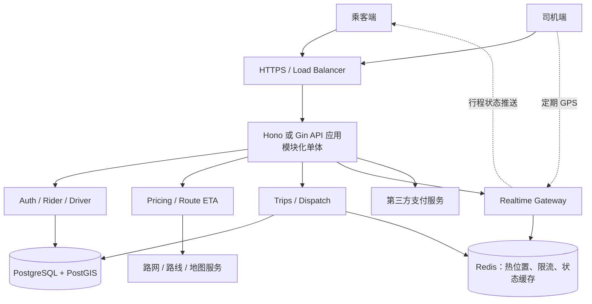
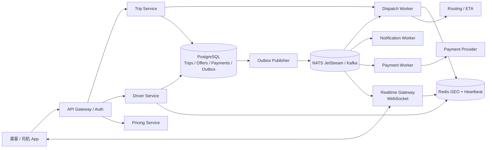
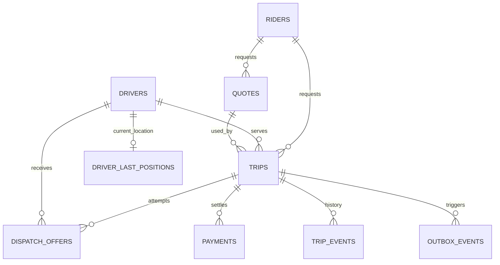
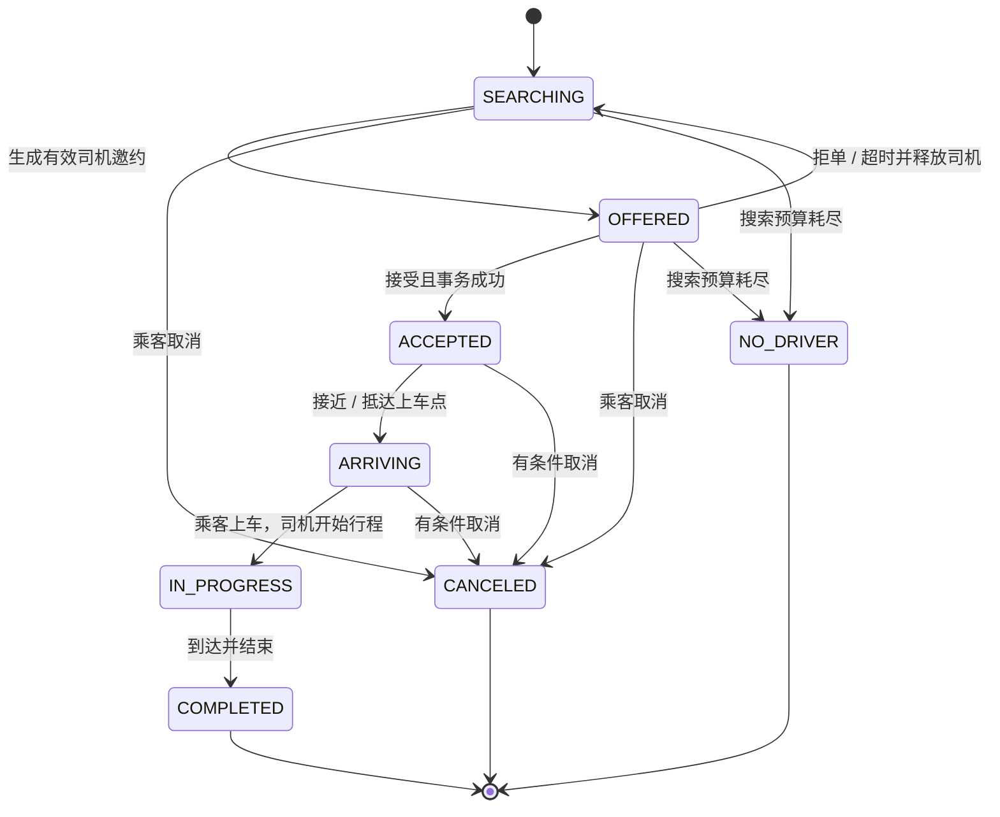
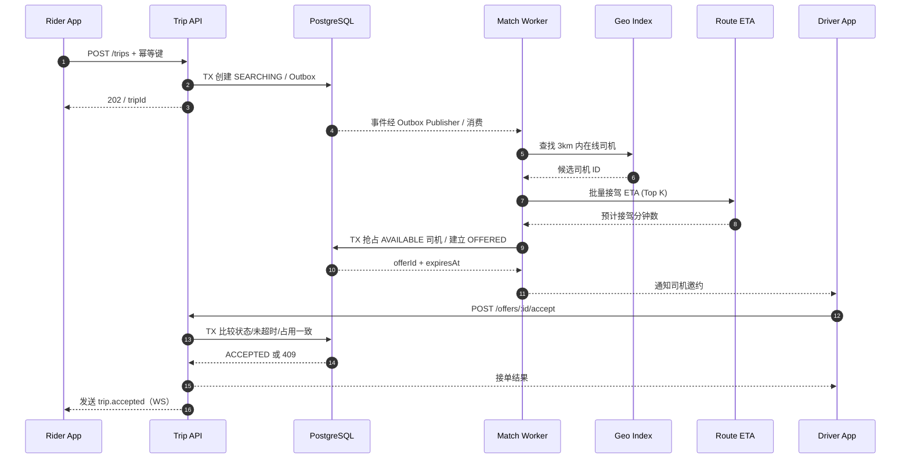
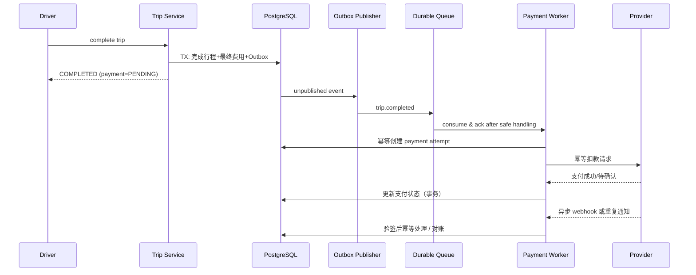

# Design Uber：网约车系统设计（System Design）

> **版本**：1.0 · 2026-10-28  
> **定位**：系统设计面试 + 工程实践参考  
> **技术主线**：PostgreSQL / PostGIS；Node.js + TypeScript + Hono；Go + Gin  
> **边界声明**：本文设计的是**Uber-like 网约车系统**，不是对 Uber 真实内部架构的完整复原。有关 Uber 实际技术实践，仅在明确引用官方资料时陈述。示例中的规模、SLO、状态机、工程选型属于学习用设计假设，需依业务验证。

## 阅读路线

1. **业务与约束**：明确到底设计什么、哪些功能暂不做。
2. **容量与指标**：将用户规模转化为 QPS、位置更新流量和延迟目标。
3. **高层架构（HLD）**：明确系统边界、数据归属与读写通路。
4. **核心数据模型（LLD）**：PostgreSQL 表、索引、约束、事务。
5. **五条关键流程**：预估价格、下单、找司机、司机接单、完成与支付。
6. **系统难点**：地理位置、派单算法、一致性、实时通知、故障恢复。
7. **工程落地**：Hono / Gin 的依赖、模块组织、代码协作与测试。
8. **演进与面试**：从单体到分布式的条件、提问与检查清单。

---

## 1. 需求澄清（Requirements）

### 1.1 角色与主链路

- **乘客（Rider）**：设定上车/下车位置、获取报价、发起叫车、查看司机与 ETA、取消、支付、查看历史。
- **司机（Driver）**：上下线、上传位置、接收邀约、接受/拒绝、抵达、开始/结束行程。
- **平台（Platform）**：发现候选司机、估算接驾时间、报价、派单、维护订单状态、结算、通知与审计。

### 1.2 功能需求（Functional Requirements）

| 优先级 | 功能 | 完成判定 |
|---|---|---|
| P0 | 身份与司机资质 | 司机必须通过认证才能上线 |
| P0 | 司机上下线与位置上报 | 仅可接单且位置新鲜的司机进入候选集 |
| P0 | 上下车点、预估车资和 ETA | 可获取可解释、带过期时间的估价 |
| P0 | 发起/取消叫车 | 重试不会产生多笔重复有效订单 |
| P0 | 寻车、邀约、接单、超时重派 | 同一司机不得同时被成功分配给两笔有效行程 |
| P0 | 行程状态变化 | 客户端能看到可恢复、顺序合理的状态 |
| P0 | 结束行程、计费与支付 | 订单和支付失败可分别补偿，不会随意重复扣费 |
| P1 | 动态定价、评价、客服 | 主链路稳定后扩充 |
| P2 | 拼车、预约车、跨城、复杂风控 | 本文不深入设计 |

### 1.3 非功能需求（Non-functional Requirements）

以下是**示例目标，并非 Uber 对外承诺**：

- 可用性：核心下单/接单流程月可用性目标 99.9%，支付和通知另设 SLO。
- 时延：查询候选司机 **p95 < 300ms**；创建订单 API **p95 < 500ms**（不包含最终匹配）；首次邀约目标数秒内（取决于地理位置与供给）。
- 正确性：禁止“双派成行”；取消、拒单、超时和接单并发必须有确定结果。
- 一致性：订单状态、司机占用、支付账务倾向强一致；地图位置、ETA 和通知允许最终一致。
- 安全：最小权限、司机/乘客数据隔离、敏感位置数据保留期限、审计和支付合规。

### 1.4 面试时必须追问

1. 设计范围是单城市、单国家还是全球？
2. 单车单客还是拼车？
3. 是否需要立即支付、预授权、现金支付？
4. 司机可同时收到几笔邀约？接受后是否允许自动取消？
5. 匹配目标是最近距离、最短接驾 ETA，还是全局平均等待时间？

**本文默认**：单乘客单司机的实时叫车；司机一次只可存在一项进行中的邀约；先支持单区域部署，保留分城市分片可能。

---

## 2. 容量估算（Back-of-the-envelope Estimation）

> 所有数字均为**练习假设**，不是实际平台规模。估算用于识别瓶颈，不用于宣称准确预测。

假定每天 100 万订单、峰值 10 万在线司机、司机每 5 秒上报一次位置、下单峰值为日均 15 倍：

| 量 | 算式 | 结果与含义 |
|---|---|---|
| 日均下单 QPS | 1,000,000 / 86,400 | 约 11.6 QPS |
| 峰值下单 QPS | 11.6 × 15 | 约 174 QPS |
| 峰值司机位置写入 | 100,000 / 5 | **20,000 次/秒** |
| 订单基础原始数据 | 1M × 2KB | 约 2GB/日（不含索引/副本/日志） |
| 位置上报峰值若持续全天 | 20,000 × 86,400 | 约 17.28 亿事件/日 |
| 单条位置事件按 120B 估算 | 17.28 亿 × 120B | 约 207GB/日原始事件（极端上界，未计索引和复制） |

**关键洞察**：最先逼出架构变化的，往往不是订单 CRUD，而是**频繁的位置更新**与**长连接扇出**。因此不应将每条实时 GPS 当作永远保留的 PostgreSQL 订单数据。位置热数据和需要持久化的行程记录应分开。

应该额外估算：每个城市可用司机分布、在线乘客数、WebSocket 长连接数、峰值路线服务调用次数、支付失败重试比例、同城热点的流量倾斜。容量估算需采用**峰值在线状态**，不能简单把全天所有司机都假设 24 小时满负荷在线。

---

## 3. 核心设计结论（先给答案）

1. **PostgreSQL 是订单/司机状态/支付记录的事实来源（Source of Truth）**；`driver.status` 与 `trip.status` 的关键状态转换在数据库事务中完成。
2. **PostGIS** 用于空间数据与中低规模附近司机查询；**Redis GEO** 用于高频更新和快速候选集检索；**H3** 用于更大规模地理分桶、供需统计与派单调度。三者不是同一种产品的互斥替代。
3. **距离近 ≠ 接驾快**：先根据空间距离召回，再通过路网 ETA、车辆类型、司机状态、取消率等排序；大规模时可从逐单贪心演进为批量匹配。Uber 对外说明过其会考虑交通、河流、道路等因素并使用批量匹配，而非只选最近司机。[Uber Marketplace Matching](https://www.uber.com/jp/ja/marketplace/matching/)
4. **不以 Redis 锁作为最终防重手段**：数据库状态条件更新、唯一索引、事务和幂等才是业务正确性的最终防线。
5. **WebSocket 是数据交付通道，不是订单真相来源**：重要事件可通过事件流 + 版本号 + HTTP 快照恢复。
6. **初版首选模块化单体（Modular Monolith）**，按 `trips / dispatch / drivers / pricing / payments / realtime` 划分业务模块；当规模与团队边界清晰后拆服务。

---

## 4. 高层架构（High-Level Design）

### 4.1 MVP：模块化单体



**实践说明**：图中的模块可全部运行在同一 API 进程，边界是代码层面的；并不代表一开始就要部署四五个微服务。开始时不一定需要 NATS、Kafka 或 H3。地图供应商（Google Maps、Mapbox、OSRM、Valhalla 等）按国家/地区合规与功能选型，路线 ETA 是外部依赖，不应简单用球面距离代替。

### 4.2 增长期：异步事件和独立网关



这里的 `Trip Service` 仍可与其他服务共享一个部署单元；拆分只在**有明确瓶颈、团队 ownership 或隔离目标**时发生。`NATS JetStream` 能持久化消息并支持消费确认/重投，因此适合作为 Go / TypeScript 之间通用的异步事件总线。[NATS JetStream](https://docs.nats.io/concepts/jetstream)

### 4.3 数据归属和一致性

| 数据 | 主要存放 | 一致性要求 | 缺失后的恢复 |
|---|---|---|---|
| 行程 `trips` / 派单 `offers` | PostgreSQL | 强一致事务 | 查询当前订单状态 |
| 司机是否有有效派单 | PostgreSQL `drivers` | 强一致事务 | 订单/司机状态对账 |
| 位置热数据 | Redis / 位置专用服务 | 最终一致、有鲜度门槛 | 司机重新上报、淘汰过期数据 |
| 订单关键位置快照 | PostgreSQL | 持久保存 | 从订单读取 |
| 页面所见 ETA | 缓存 / 路线服务 | 可降级 | 用最近一次 ETA 并标记过期 |
| 事件 `outbox` | PostgreSQL -> JetStream | 至少一次投递，消费者幂等 | 重试、重放、对账 |
| 费用/付款凭证 | PostgreSQL + 支付服务商 | 幂等和对账优先 | Webhook、主动查询、补偿 |

---

## 5. 数据模型（PostgreSQL / PostGIS）

### 5.1 核心实体关系



实体职责：

- `riders`：乘客身份；不放实时定位。
- `drivers`：司机资质、城市、业务占用状态、当前预留订单。
- `driver_last_positions`：初期可用 PostGIS 做最后位置；扩容后热位置迁入 Redis，数据库只保留必要快照。
- `quotes`：乘客所属的报价快照、计价版本、金额和过期时间，防止客户端直接指定价格。
- `idempotency_requests`：保障重复 HTTP 请求不会再次执行已完成的命令。
- `trips`：唯一的行程主记录；保存上下车点快照、报价/结算金额、状态、司机归属与版本。
- `dispatch_offers`：一次派单邀约与过期时间，支持多次重派和审计。
- `trip_events`：关键状态变化审计，避免只靠可覆盖的 `trips.status` 解释历史。
- `payments`：订单支付意图与第三方支付标识；与行程状态独立。
- `outbox_events`：同事务落库的待发布领域事件。
- `processed_events`（Inbox）：消费者去重记录；与消费侧业务结果尽量同事务提交。

### 5.2 代表性 DDL（教学基线）

以下 SQL 着重展示**约束、索引、关系与基本业务不变量**，实际生产还需完备身份、数据保留、审计策略与数据迁移方案。

```sql
CREATE EXTENSION IF NOT EXISTS postgis;

CREATE TABLE riders (
  id uuid PRIMARY KEY DEFAULT gen_random_uuid(),
  created_at timestamptz NOT NULL DEFAULT now()
);

CREATE TABLE drivers (
  id uuid PRIMARY KEY DEFAULT gen_random_uuid(),
  city_id text NOT NULL,
  approved boolean NOT NULL DEFAULT false,
  status text NOT NULL DEFAULT 'OFFLINE'
    CHECK (status IN ('OFFLINE','AVAILABLE','OFFERED','EN_ROUTE','ON_TRIP')),
  reserved_trip_id uuid,  -- 仅在 OFFERED 时持有待确认订单标识
  updated_at timestamptz NOT NULL DEFAULT now(),
  CHECK ((status = 'OFFERED') = (reserved_trip_id IS NOT NULL))
);

CREATE TABLE driver_last_positions (
  driver_id uuid PRIMARY KEY REFERENCES drivers(id),
  location geography(Point, 4326) NOT NULL,
  observed_at timestamptz NOT NULL
);
CREATE INDEX driver_location_gix
  ON driver_last_positions USING gist (location);
CREATE INDEX driver_status_city_idx
  ON drivers (city_id, status) WHERE approved = true;

CREATE TABLE quotes (
  id uuid PRIMARY KEY DEFAULT gen_random_uuid(),
  rider_id uuid NOT NULL REFERENCES riders(id),
  city_id text NOT NULL,
  pickup geography(Point, 4326) NOT NULL,
  dropoff geography(Point, 4326) NOT NULL,
  estimated_fare_minor bigint NOT NULL CHECK (estimated_fare_minor >= 0),
  currency char(3) NOT NULL,
  pricing_version text NOT NULL,
  expires_at timestamptz NOT NULL,
  created_at timestamptz NOT NULL DEFAULT now()
);
CREATE INDEX quotes_rider_expires_idx ON quotes(rider_id, expires_at DESC);

CREATE TABLE trips (
  id uuid PRIMARY KEY DEFAULT gen_random_uuid(),
  rider_id uuid NOT NULL REFERENCES riders(id),
  quote_id uuid NOT NULL REFERENCES quotes(id),
  driver_id uuid REFERENCES drivers(id),
  city_id text NOT NULL,
  pickup geography(Point, 4326) NOT NULL,
  dropoff geography(Point, 4326) NOT NULL,
  status text NOT NULL DEFAULT 'SEARCHING'
    CHECK (status IN ('SEARCHING','OFFERED','ACCEPTED','ARRIVING',
                     'IN_PROGRESS','COMPLETED','CANCELED','NO_DRIVER')),
  offered_driver_id uuid REFERENCES drivers(id),
  estimated_fare_minor bigint NOT NULL CHECK (estimated_fare_minor >= 0),
  final_fare_minor bigint CHECK (final_fare_minor >= 0),
  currency char(3) NOT NULL,
  version bigint NOT NULL DEFAULT 0,
  created_at timestamptz NOT NULL DEFAULT now(),
  updated_at timestamptz NOT NULL DEFAULT now(),
  CHECK (status <> 'OFFERED' OR offered_driver_id IS NOT NULL)
);

-- 一个司机同时最多只能承担一单“已成功接受的进行中行程”。
CREATE UNIQUE INDEX one_active_trip_per_driver
  ON trips(driver_id)
  WHERE status IN ('ACCEPTED','ARRIVING','IN_PROGRESS');

-- 若业务限制同一乘客同时仅能拥有一个未终结行程：
CREATE UNIQUE INDEX one_active_trip_per_rider
  ON trips(rider_id)
  WHERE status IN ('SEARCHING','OFFERED','ACCEPTED','ARRIVING','IN_PROGRESS');
CREATE INDEX trips_rider_created_idx ON trips(rider_id, created_at DESC);
CREATE INDEX trips_status_created_idx ON trips(status, created_at);

CREATE TABLE dispatch_offers (
  id uuid PRIMARY KEY DEFAULT gen_random_uuid(),
  trip_id uuid NOT NULL REFERENCES trips(id),
  driver_id uuid NOT NULL REFERENCES drivers(id),
  status text NOT NULL DEFAULT 'PENDING'
    CHECK (status IN ('PENDING','ACCEPTED','DECLINED','EXPIRED','REVOKED')),
  expires_at timestamptz NOT NULL,
  created_at timestamptz NOT NULL DEFAULT now(),
  responded_at timestamptz
);
-- 同一订单最多一个待决邀约；同一司机最多一个待决邀约。
CREATE UNIQUE INDEX one_pending_offer_per_trip
  ON dispatch_offers(trip_id) WHERE status = 'PENDING';
CREATE UNIQUE INDEX one_pending_offer_per_driver
  ON dispatch_offers(driver_id) WHERE status = 'PENDING';
CREATE INDEX offers_due_idx ON dispatch_offers(expires_at)
  WHERE status = 'PENDING';

CREATE TABLE trip_events (
  id bigserial PRIMARY KEY,
  trip_id uuid NOT NULL REFERENCES trips(id),
  version bigint NOT NULL,
  type text NOT NULL,
  data jsonb NOT NULL DEFAULT '{}'::jsonb,
  created_at timestamptz NOT NULL DEFAULT now(),
  UNIQUE(trip_id, version)
);

CREATE TABLE payments (
  id uuid PRIMARY KEY DEFAULT gen_random_uuid(),
  trip_id uuid NOT NULL UNIQUE REFERENCES trips(id),
  provider text NOT NULL,
  provider_payment_id text,
  amount_minor bigint NOT NULL CHECK (amount_minor >= 0),
  currency char(3) NOT NULL,
  status text NOT NULL DEFAULT 'PENDING'
    CHECK (status IN ('PENDING','PROCESSING','SUCCEEDED','FAILED','REFUNDED')),
  created_at timestamptz NOT NULL DEFAULT now(),
  UNIQUE(provider, provider_payment_id)
);

CREATE TABLE outbox_events (
  id uuid PRIMARY KEY DEFAULT gen_random_uuid(),
  aggregate_type text NOT NULL,
  aggregate_id uuid NOT NULL,
  event_type text NOT NULL,
  payload jsonb NOT NULL,
  created_at timestamptz NOT NULL DEFAULT now(),
  published_at timestamptz
);
CREATE INDEX outbox_unpublished_idx ON outbox_events(created_at)
  WHERE published_at IS NULL;

CREATE TABLE idempotency_requests (
  actor_role text NOT NULL CHECK(actor_role IN ('RIDER','DRIVER')),
  actor_id uuid NOT NULL,
  operation text NOT NULL,
  key text NOT NULL,
  request_hash text NOT NULL,
  status text NOT NULL DEFAULT 'PROCESSING'
    CHECK (status IN ('PROCESSING','COMPLETED')),
  response_status integer,
  response_body jsonb,
  CHECK (status <> 'COMPLETED' OR
         (response_status IS NOT NULL AND response_body IS NOT NULL)),
  created_at timestamptz NOT NULL DEFAULT now(),
  expires_at timestamptz NOT NULL,
  PRIMARY KEY(actor_role, actor_id, operation, key)
);

CREATE TABLE processed_events (
  consumer_name text NOT NULL,
  event_id uuid NOT NULL,
  processed_at timestamptz NOT NULL DEFAULT now(),
  PRIMARY KEY(consumer_name, event_id)
);
```

**注意**：`payments(provider, provider_payment_id)` 允许多个 `NULL`（PostgreSQL 默认语义）；这里额外以 `UNIQUE(trip_id)` 约束“每单一个支付意图”。若支持多次实际扣款尝试，应建立 `payment_attempts`，并将每次请求的服务商幂等键持久化、设置唯一约束。`idempotency_requests` 采用同事务 `PROCESSING → COMPLETED` 的实现：先插入尚未提交的处理中记录（唯一键使其他并发插入等待），再在**同一数据库事务**中完成订单/Outbox 写入、更新保存响应，最后提交；并发请求核验 `request_hash`，匹配则重放已保存结果，不匹配则返回 409。因处理中记录未单独提交，进程崩溃会使它和未完成业务一起回滚。未提交的事务不能提前宣称请求成功。文中 `reserved_trip_id` 的外键关系和更严格的跨表状态约束可在迁移中补足，但不能仅靠 `CHECK` 保证跨表不变量。

**为何部分唯一索引重要？** 因为业务要求的不是“司机一生只能有一单”，而是“同一时刻至多一单有效行程”。PostgreSQL 支持 `WHERE` 谓词限定唯一索引作用范围。[官方：Partial Indexes](https://www.postgresql.org/docs/current/indexes-partial.html)

### 5.3 地理查询

```sql
-- geography 距离单位为米。查询 3km 内且位置 15s 内更新的司机。
-- 参数：$1 经度，$2 纬度，$3 城市标识。
SELECT d.id, ST_Distance(
         p.location,
         ST_SetSRID(ST_MakePoint($1, $2), 4326)::geography
       ) AS air_distance_m
FROM driver_last_positions p
JOIN drivers d ON d.id = p.driver_id
WHERE d.city_id = $3
  AND d.approved = true
  AND d.status = 'AVAILABLE'
  AND p.observed_at >= now() - interval '15 seconds'
  AND ST_DWithin(
        p.location,
        ST_SetSRID(ST_MakePoint($1, $2), 4326)::geography,
        3000
      )
ORDER BY air_distance_m ASC
LIMIT 30;
```

- 坐标顺序：`ST_MakePoint(longitude, latitude)`，不要颠倒。
- `geography` 的 `ST_DWithin` 距离以**米**为单位；创建 GiST 索引使范围过滤可受益。[PostGIS ST_DWithin](https://postgis.net/docs/ST_DWithin.html)
- `ST_DWithin` 用于**候选召回**；最终排序依据路网 ETA，不能把 `ST_Distance` 直接当行车距离。
- 在真实高频场景，不建议把所有司机每几秒的连续轨迹都持续写入同一张主订单库热表。

---

## 6. API、事件协议与幂等

### 6.1 REST API 草案

| 操作 | 路由 | 核心字段 / 返回 |
|---|---|---|
| 预估费用 | `POST /v1/quotes` | pickup、dropoff、vehicleType → quoteId、amount、currency、eta、expiresAt |
| 创建叫车 | `POST /v1/trips` | quoteId、`Idempotency-Key` → tripId、status |
| 获取行程 | `GET /v1/trips/:id` | 当前状态、司机、报价、版本、时间戳 |
| 乘客取消 | `POST /v1/trips/:id/cancel` | reason + 幂等键 → 取消结果 |
| 司机上线 | `POST /v1/drivers/me/online` | driver status |
| 司机下线 | `POST /v1/drivers/me/offline` | 处于行程中时拒绝/延后 |
| 上传位置 | `POST /v1/drivers/me/location`（早期） | lat、lon、observedAt、sequence |
| 司机接单 | `POST /v1/offers/:id/accept` | offerId、幂等键 → tripId 或冲突 |
| 司机拒单 | `POST /v1/offers/:id/decline` | offerId → 已拒绝 |
| 到达接客点 | `POST /v1/trips/:id/arrive` | expectedVersion 或服务器条件状态 |
| 开始行程 | `POST /v1/trips/:id/start` | 行程状态变更 |
| 完成行程 | `POST /v1/trips/:id/complete` | 计价快照、金额、支付状态 |
| 事件订阅 | `GET /v1/realtime`（WS Upgrade） | authenticated subscribe, replay cursor |

**公共约定**：鉴权身份来自服务端校验 token 而非 body 中的 `riderId`；金额全部用最小货币单位（如分）整数保存；客户端命令须校验权限、行程归属、状态和时间戳；传入坐标须校验范围、城市/道路可达性。创建订单与发起支付都必须使用幂等键，键绑定**用户 + 具体操作 + 请求参数摘要**，相同键不同参数返回冲突。

### 6.2 幂等键落库语义（避免重复订单）

1. 规范化请求参数生成 `request_hash`，用 `(actor_role, actor_id, operation, key)` 标识一次业务命令。
2. 开启数据库事务，先尝试 `INSERT` 状态为 `PROCESSING` 的幂等行或检查已提交的既有行；**新幂等行、订单、Outbox、状态改为 `COMPLETED` 并存储最终响应**应在同一个事务中提交。
3. 若数据库发现已有相同键并且哈希相同，直接重放已提交响应；哈希不同返回 `409 IDEMPOTENCY_KEY_REUSED`。
4. 多个并发请求争抢同一唯一键时，数据库唯一约束能串行化冲突插入；要处理唯一冲突/等待、客户端超时后结果未知等情况。
5. 到期清理前必须覆盖业务重试窗口；创建订单的其他业务唯一约束仍需保留，不能只靠幂等键。

### 6.3 例子：创建行程

```http
POST /v1/trips
Authorization: Bearer <token>
Idempotency-Key: 0c2f...unique-per-attempt
Content-Type: application/json

{"quoteId":"...","pickup":{"lat":31.23,"lon":121.47},"dropoff":{"lat":31.20,"lon":121.50}}
```

```json
{
  "tripId": "c1a0...",
  "status": "SEARCHING",
  "version": 1,
  "requestId": "..."
}
```

### 6.4 WebSocket 事件 Envelope

```json
{
  "eventId": "...",
  "type": "trip.offer_created",
  "aggregateId": "trip-uuid",
  "version": 3,
  "occurredAt": "2026-10-28T01:00:00Z",
  "payload": { "offerId": "...", "expiresAt": "..." }
}
```

`version` 按**同一 trip** 单调递增；不同 trip 不保证全局顺序。断线重连后，客户端先取最新 `GET /trips/:id` 快照，再从服务端可回放事件或轮询拉齐；旧事件用 version 丢弃，缺版本则拉取快照。不要假设 WebSocket 消息“到达一次且严格有序”就等于业务状态一致。

---

## 7. 行程与邀约状态机（最重要的面试点）

### 7.1 Trip 状态



`NO_DRIVER` 表示终结状态，**不能**重置为 `SEARCHING`；用户重新发起请求时创建新订单。已开始的行程若中断，不应简单走普通取消，需要单独异常结束/申诉/费用规则（本文略）。

### 7.2 Driver 状态

`OFFLINE -> AVAILABLE -> OFFERED -> EN_ROUTE -> ON_TRIP -> AVAILABLE`。

- `OFFERED` 表示司机被**暂时预留**，但尚未接单；不代表已成功分配。
- 接单后 `EN_ROUTE`；开始行程后 `ON_TRIP`；结束/取消后经规则恢复 `AVAILABLE` 或 `OFFLINE`。
- 超时恢复必须校验 `reserved_trip_id` 仍是当前订单，防止旧超时任务释放新订单的占用。
- `drivers.status` 是事务内原子更新的“资格与占用”状态；Redis `available` 集合只是加速召回的投影，异步同步可能暂时偏差。

---

## 8. 派单详细设计（Dispatch / Matching）

### 8.1 从候选到接单



### 8.2 匹配策略演进

**V1：顺序邀约**：半径 2–3km → 找前 30 名候选 → 按接驾 ETA 排序 → 一次只预留 1 位司机 → 等 10–15 秒（示例）→ 拒绝/超时则顺序尝试下一位。这种实现较易保证公平性和正确性。

**V2：多因素评分**：过滤车种/城市/司机合规/位置鲜度后，评价：

```text
score(driver, trip) =
  w1 * normalized_pickup_ETA
+ w2 * cancellation_risk
+ w3 * expected_detour
+ w4 * supply_balance_penalty
```

评分越低越好。以上仅是教学上可解释的评分草案；权重须通过离线实验和 A/B 测试确定。

**V3：批量匹配**：聚合数秒内的乘客与司机候选，构建二分图，以总等待时间/取消率/公平性为目标做近似最优化（如最小费用匹配），减少局部贪心产生的总体低效。Uber 官方说明其匹配系统经历了由最近司机到 batch matching 的演进。[Uber Marketplace Matching](https://www.uber.com/jp/ja/marketplace/matching/)

### 8.3 为什么不能仅靠 `SETNX driver_lock`？

如果 Redis 锁过期，老请求仍可能继续操作；网络分区、应用进程暂停、重试都可能让“我持有过锁”变成错误的授权。真正需要保证的是**订单与司机的业务不变量**。关键检查必须在同一个 PostgreSQL 事务内成功或回滚。Redis 锁可以作为减小碰撞率的**优化**，不能作为唯一正确性保障。

### 8.4 单司机预留：关键事务（伪 SQL）

```sql
BEGIN;
-- 1. 锁定订单，并检查仍可派单。
SELECT id, status FROM trips WHERE id = $trip_id FOR UPDATE;
-- 应用层要求 status = 'SEARCHING'，否则 ROLLBACK。

-- 2. 只有 AVAILABLE 的司机才允许预留。
UPDATE drivers
SET status = 'OFFERED', reserved_trip_id = $trip_id, updated_at = now()
WHERE id = $driver_id
  AND city_id = $city_id
  AND approved = true
  AND status = 'AVAILABLE'
RETURNING id;
-- 返回 0 行：竞争失败，ROLLBACK，尝试其他司机。

-- 3. 保存派单邀请（过期时间由服务端统一设置）。
INSERT INTO dispatch_offers(id, trip_id, driver_id, expires_at)
VALUES ($offer_id, $trip_id, $driver_id, $expires_at);

-- 4. 状态调整和事件持久化必须包含在同一事务。
UPDATE trips
SET status='OFFERED', offered_driver_id=$driver_id,
    version=version+1, updated_at=now()
WHERE id=$trip_id AND status='SEARCHING';
-- 期望更新恰好 1 行，否则回滚。

INSERT INTO trip_events(trip_id, version, type, data)
SELECT id, version, 'trip.offer_created',
       jsonb_build_object('offerId', $offer_id)
FROM trips WHERE id=$trip_id;
INSERT INTO outbox_events(aggregate_type, aggregate_id, event_type, payload)
VALUES ('trip', $trip_id, 'trip.offer_created',
        jsonb_build_object('tripId',$trip_id,'offerId',$offer_id));
COMMIT;
```

正确性细节：锁定顺序要固定（例如先订单、后司机），缩短事务时间，避免在事务里调用路线 API、发 WebSocket 或调用第三方支付。`SELECT ... FOR UPDATE` 是 PostgreSQL 行级锁；`SKIP LOCKED` 更适合多 worker 取队列任务，不适合用它跳过业务订单来绕过状态机校验。[PostgreSQL locking](https://www.postgresql.org/docs/current/sql-select.html)

### 8.5 接受、拒绝、超时与取消竞争

**接受邀约的事务**：

1. 校验请求人是对应司机，且 `offer.status = PENDING`，`expires_at > now()`。
2. 锁订单行，确认 `trip.status = OFFERED` 且 `offered_driver_id = 当前司机`。
3. 锁司机行，确认 `status = OFFERED` 且 `reserved_trip_id = 当前 trip`。
4. 将 `offer -> ACCEPTED`，`trip -> ACCEPTED`（写入 `driver_id`），`driver -> EN_ROUTE`、清空 `reserved_trip_id`。
5. 更新 version、写 trip event 和 outbox，事务提交。已有活跃订单的数据库唯一约束还能兜底。

**拒绝/超时**：同样锁订单和司机，只在原邀约仍 `PENDING` 且订单仍 `OFFERED` 时把邀约标为 `DECLINED/EXPIRED`，司机回 `AVAILABLE`，订单回 `SEARCHING`，发出下一轮派单事件。**过期判定使用数据库时间或统一可信时间源**，不能仅凭某个 worker 本地定时器。

**取消与接受并发**：只允许一个事务赢。若取消先提交，司机接受返回 `409 OFFER_UNAVAILABLE`；若接受先提交，则按“已接单取消”规则处理。不能两个 API 都返回无条件成功。

**旧消息晚到**：出站事件带 `offerId`、`tripId`、`tripVersion`；worker 每次处理前都重新验证当前状态。事件通知可能重复，必须保证重放不会再次扣款或重复派单。

---

## 9. 地理位置索引与实时定位

### 9.1 三种常见手段的分工

| 技术 | 强项 | 局限与边界 | 本设计何时采用 |
|---|---|---|---|
| PostgreSQL + PostGIS | 空间 SQL、复杂条件、持久查询与事务结合 | 高频位置写入会给主数据库带来较大压力 | **MVP 首选**，可解释且易验证 |
| Redis GEO | `GEOADD` / `GEOSEARCH`，就近位置检索快 | 无跨 Redis/PostgreSQL 原子事务、不是路网 ETA 引擎；需要手动清理成员的陈旧状态 | 在线司机多、位置更新频繁时 |
| Uber H3 | 六边形网格、相邻 cell 查询、区域统计与供需平衡 | 网格是离散近似；不能替代路径规划、路线 ETA 或数据库一致性 | 多城市热点优化、分桶、批量派单/定价 |

PostGIS 的 `ST_DWithin(geography, geography, meters)` 支持距离过滤；Redis 提供 `GEOSEARCH ... BYRADIUS`；Uber 曾介绍 H3 用于地理空间分析、定价和派单。[PostGIS](https://postgis.net/docs/ST_DWithin.html) · [Redis GEOSEARCH](https://redis.io/docs/latest/commands/geosearch/) · [Uber H3](https://www.uber.com/us/en/blog/h3/)

### 9.2 Redis 位置模型（扩容方案）

```text
geo:drivers:{city}           -> GEO sorted set，member = driverId
location:heartbeat:{driver} -> string/hash (lat,lon,observedAt,seq), TTL=15s
```

每次有效位置上报：鉴权 → 检查司机在线、城市与坐标合法 → 去掉落后序列数据 → 更新 GEO member + 司机心跳 TTL。**Redis GEO 集合中的单个成员不会随另一个 heartbeat key 的 TTL 自动消失**：查询结果还需根据心跳/时间戳过滤，后台清理过期 GEO 成员；设计好并发更新和心跳超时的原子性（Lua 脚本或受控服务流程），避免旧清理误删新位置。司机进入 `OFFERED/EN_ROUTE/ON_TRIP` 时，从可接单索引移除或查询时二次确认 PostgreSQL 占用状态。

Redis 例子：

```redis
GEOADD geo:drivers:shanghai 121.4700 31.2300 driver-42
GEOSEARCH geo:drivers:shanghai FROMLONLAT 121.475 31.232 BYRADIUS 3 km ASC COUNT 30 WITHDIST
```

返回的是**空间候选**，不能直接确认为最终可接单司机；还要过滤状态、位置鲜度和路网 ETA。

### 9.3 位置上报协议

- 上报数据含 `driverId（由 token 推导）`、`lat`、`lon`、`observedAt`、`seq`、`accuracyM`。
- 对乱序：对同一设备会话根据单调 `seq` 拒绝旧位置；重连后先协商新 session/epoch，避免序列重置导致拒绝所有新数据。
- 对异常：拒绝离谱跳点、非法定位、过旧时间戳，可采用 GPS 精度阈值；不要凭一次位置跳变自动断言欺诈。
- 行程进行中只将该司机位置发给**有权限的匹配乘客**，以房间 `trip:{id}` 为边界；不能全城市广播 GPS。
- 对数据隐私：最小保留期、按地区法律约束、加密传输与存储、访问日志、角色隔离；司机离线后移除可接单索引。

---

## 10. 实时通信（Realtime）

### 10.1 HTTP 与 WebSocket 各做什么？

- **HTTP**：会产生业务状态的命令（创建、接单、取消、开始/完成）、可靠快照查询、支付通知 webhook。
- **WebSocket**：司机位置更新（高频场景）、司机邀约提示、行程状态的低延迟推送。
- **Push Notification**：司机 App 在后台或断线时的提醒，但不能作为成功接单的确认依据。
- **消息总线**：负责应用内部的持久异步任务或跨服务事件；与面向终端的 WebSocket 不同。

### 10.2 多实例路由问题

司机连在 WS 节点 B，乘客连在节点 A，Trip 服务在 C：C 无法只调用本机 WebSocket 连接。因此：

1. 连接注册表保存 `userId -> ws-node/session`（有 TTL、心跳和会话版本）。
2. Trip 事务完成后产生事件，Realtime Gateway 消费并路由至对应 session。
3. 重要事件断线丢失时，由**可持久化事件 + HTTP 状态快照**恢复。

Redis Pub/Sub 适合在线低延迟广播，但**at-most-once**（离线消息不重发）；不能用它承担支付完成等不可丢事件的唯一来源。需持久化的业务事件可使用 Outbox + NATS JetStream 或其他持久队列。[Redis Pub/Sub delivery semantics](https://redis.io/docs/latest/develop/pubsub/) · [NATS JetStream](https://docs.nats.io/concepts/jetstream)

### 10.3 连接治理

JWT 握手鉴权 + token 过期重认证、Ping/Pong 心跳、连接数/用户上限、慢消费者断连/合并位置消息、背压、断线指数退避与随机抖动、应用版本与事件 schema 兼容。不能只监控 HTTP p95，而忽略 WS 消息积压和重连风暴。

---

## 11. 报价、完成行程和支付

### 11.1 报价（Quote）

`estimated fare = 起步价 + 预估里程费用 + 预估时长费用 + 动态加成 + 预计附加费`。

- 路线服务提供预估距离与 ETA；历史数据和城市运价规则决定金额。
- 生成 `quoteId`、`pricingVersion`、`expiresAt`、币种与计算明细快照。
- 订单创建时验证 quote 属于当前乘客、未过期、未被篡改，服务端决定价格。
- `float` 不适合货币的最终精确结算；金额以**最小货币单位的整数**或固定精度 decimal 存储。

### 11.2 完成与支付的跨系统一致性



**为什么不能直接在结束行程的数据库事务里扣款？** 因为数据库事务不能原子控制外部支付商；外部网络可能超时而实际上扣款成功，导致重试双扣。应将**行程完成**与**支付处理**分为两个状态机，通过幂等键、Outbox、Webhook 和对账推进最终一致性。

支付失败不应把 `COMPLETED` 行程重置为 `IN_PROGRESS`。需要独立 `payments` / `payment_attempts`，错误重试、人工工单和退款是另一路流程。不得在原始日志记录卡号或支付密钥。

---

## 12. 消息队列、事务 Outbox、Inbox、重试

### 12.1 为什么需要消息队列？

下单时如果在 HTTP 请求线程里同步做：数据库写入 → 路线 ETA → 等待司机回应 → 发通知 → 支付调用，将导致超时、级联故障、扩容困难。队列的价值主要在于：

- **削峰**：派单 worker 按吞吐能力消费而不是把所有请求压进 API。
- **解耦**：完成行程不必等待支付商和通知通道成功才返回。
- **故障恢复**：可持久化消息在消费者宕机后重投。
- **任务编排**：派单重试、超时回收、补偿与对账。

### 12.2 Outbox 保证什么，不能保证什么？

订单事务 `INSERT trips` 同时 `INSERT outbox_events`：两者要么都提交，要么都不提交。独立 Publisher 扫描 `published_at IS NULL` 事件并发到 JetStream，收到 broker 确认后标记 published。

- **允许重复发布**：发送成功、标记已发之前崩溃会重发。
- **消费者必须幂等**：基于 `eventId` 或 `(consumer_name,event_id)` 唯一记录消费结果，确保重复事件不重复副作用。
- **保证至少一次尝试**，不是天然的“端到端恰好一次”。
- **超时工作项**：可扫描待决 offer 的 `expires_at`；规模扩大后用延迟任务加持久化定期兜底。只依赖某个进程内 `setTimeout` / `time.AfterFunc` 会在进程重启后丢任务。

示例 worker 消费规则：读取 → 验证 schema 和 eventId → 事务内校验当前订单状态 → 执行业务改变与 inbox 标记 → 成功提交 → ACK。处理失败重试时做指数退避、最大次数、死信/人工恢复和告警。

### 12.3 技术取舍

| 方案 | 什么时候适用 | 代价 |
|---|---|---|
| PostgreSQL Outbox + 定时 worker | 最初版本、业务量不大 | 轮询延迟与数据库负担；需清理表 |
| Redis Streams | 现有 Redis、任务量中等、需消费组 | 要正确处理 pending/reclaim/保留策略 |
| NATS JetStream | TS/Go 双技术栈、持久事件与简单消费模型 | 额外服务与运维、投递仍需幂等 |
| Kafka | 超高吞吐、长保留、跨团队流式数据平台 | 分区、顺序、容量和运维复杂度更高 |

**推荐**：MVP 先用 PostgreSQL Outbox + worker；学习升级版使用 **NATS JetStream** 体验消息重试与消费者；只有流式规模/生态诉求出现再考虑 Kafka。

---

## 13. 一致性、缓存与故障矩阵

### 13.1 三条必须成立的 Invariants

1. 一个司机同时至多有一个**已接受且活跃**行程；同一时间最多有一个待决定邀约。
2. 一个行程从 `OFFERED` 变 `ACCEPTED` 时，司机与订单必须在**同一个事务**中一起完成迁移。
3. 支付平台请求即使重试 N 次，也只能按业务意图处理为同一付款，回调重放不会重复计费。

### 13.2 常见失败场景

| 失败 | 错误处理方式 | 正确做法 |
|---|---|---|
| 两个乘客同时叫到同一司机 | 仅查缓存 available 就各自派单 | 司机 `AVAILABLE → OFFERED` 的 DB CAS，唯一约束兜底 |
| 司机刚接受，乘客同时取消 | 两边 API 都返回成功 | 同事务状态检查，竞争输的一方给确定冲突/改用已接单取消流程 |
| 邀约到期后旧 accept 才到 | 只看司机是否在线 | 核验 offerId、状态、expiresAt、tripId |
| 位置 30 秒没更新 | 仍按上次 GPS 派单 | 候选召回按 heartbeat 鲜度过滤，并清理缓存索引 |
| Redis 节点故障 | 整个业务假定 Redis 一定可靠 | 临时回退 PostGIS/暂停新派单，并以 PG 恢复状态投影 |
| WebSocket 断线 | 订单状态完全丢失 | 重连取 HTTP 快照、按版本去重和补事件 |
| 事件发布重复 | 重复给司机派单/扣款 | inbox/eventId 幂等、状态机校验 |
| 订单已完成，支付超时 | 直接标记扣款失败并再次随机发起 | 同一支付意图幂等重试或查支付网关交易状态 |
| MQ 长时间不可用 | 丢弃 outbox 事件 | Outbox 保留并积压重试；监控事件延迟 |
| 多区域网络分区 | 双区域同时写同一活跃订单 | 为订单确定单一写主区域和故障切换 fencing/仲裁机制 |

### 13.3 缓存与读写设计

- 用户、报价、地图可做缓存，但**可用司机集合是近实时索引，不能视为事务事实来源**。
- `GET /trips/:id` 强一致路径优先从主库读或使用能保证 read-your-writes 的架构；不要在接单后立即从滞后只读副本查询，导致 UI 回退成 `SEARCHING`。
- 通过应用协议 `trip.version` 防止旧事件覆盖新状态；缓存失效要设计 TTL、主动失效和重建路径。

---

## 14. Node.js / TypeScript + Hono 工程方案

### 14.1 包选择与原因

| 领域 | 推荐工具 | 职责 / 原因 |
|---|---|---|
| HTTP | `hono` + `@hono/node-server` | REST、路由、中间件、Node 运行时入口 |
| 校验 | `zod` + `@hono/zod-validator` | DTO 参数校验、数据契约；服务层不接收原始不可信请求体 |
| PostgreSQL | `pg`（node-postgres） | 显式事务、SQL、PostGIS 查询；便于学习底层并发控制 |
| ORM / Query Builder（可选） | `drizzle-orm` + `drizzle-kit` | CRUD 类型体验和迁移；复杂空间 SQL/锁可保留手写 SQL |
| Redis | `ioredis` 或 `redis` | GEO、心跳、缓存、Pub/Sub；选一个统一用 |
| 消息 | `nats`（NATS.js） | JetStream 发布/消费、事件异步化 |
| WebSocket | `@hono/node-server` + `ws` | 连接、鉴权、心跳、房间路由；不要只用内存房间解决多实例 |
| H3（进阶） | `h3-js` | cell、邻居遍历与热区分桶 |
| 可观测性 | `pino`、OpenTelemetry SDK | 结构化日志、Trace、Metrics |
| 测试 | `vitest`、`testcontainers` | 业务单测、真实 PostgreSQL / Redis 集成测试 |

Hono 官方 Node 文档已说明 `@hono/node-server` 内置 Node WebSocket 支持，配合 `ws`；`@hono/node-ws` 已废弃，网上旧教程需警惕。[Hono Node.js](https://hono.dev/docs/getting-started/nodejs) · [Hono Validation](https://hono.dev/docs/guides/validation)

### 14.2 目录组织：按业务模块，而非按所有 controller/service/repository 平铺

```text
uber-hono/
├─ src/
│  ├─ app.ts                      # Hono app + middleware + 路由注册
│  ├─ main.ts                     # Node 启动/优雅退出
│  ├─ modules/
│  │  ├─ trips/
│  │  │  ├─ trips.routes.ts       # HTTP 适配层
│  │  │  ├─ trips.schemas.ts      # Zod DTO
│  │  │  ├─ trips.service.ts      # 创建/取消/状态迁移
│  │  │  ├─ trips.repository.ts   # PostgreSQL
│  │  │  ├─ trip-state.ts         # 无 IO 的领域规则
│  │  │  └─ trips.test.ts
│  │  ├─ dispatch/
│  │  │  ├─ dispatch.worker.ts
│  │  │  ├─ dispatch.service.ts
│  │  │  ├─ matching.strategy.ts
│  │  │  └─ dispatch.repository.ts
│  │  ├─ drivers/
│  │  ├─ locations/
│  │  ├─ pricing/
│  │  ├─ payments/
│  │  └─ realtime/
│  ├─ infrastructure/
│  │  ├─ db/ (pool, tx, migrations)
│  │  ├─ redis/
│  │  ├─ messaging/ (outbox, nats)
│  │  ├─ maps/ (ETA adapter)
│  │  └─ observability/
│  └─ shared/ (errors, auth, time, ids)
├─ migrations/
├─ test/integration/
├─ docker-compose.yml
└─ package.json
```

**调用边界**：Route（认证/校验/映射）→ Application Service（事务编排）→ Domain policy（状态规则与匹配策略）→ Repository（数据库持久化）→ Outbox。`dispatch.service` 可以调用 `TripRepository` 暴露的受控操作，**不能自己在独立数据库连接里悄悄修改订单状态**。跨模块写入需要共享同一事务对象/Unit of Work。

### 14.3 Hono HTTP handler 的职责（示意片段，非完整可运行应用）

```ts
// trips.routes.ts：校验数据、获得鉴权上下文、调用业务服务。
app.post('/v1/trips', zValidator('json', createTripSchema), async (c) => {
  const actor = c.get('principal'); // 鉴权中间件注入，必须验证是 RIDER
  const key = c.req.header('Idempotency-Key');
  if (!key) return c.json({ error: 'IDEMPOTENCY_KEY_REQUIRED' }, 400);

  const result = await tripService.createTrip({
    riderId: actor.id,
    input: c.req.valid('json'),
    idempotencyKey: key,
  });
  return c.json(result, 202);
});
```

真实工程要把 `principal` 的 Hono Variables 类型、JWT 校验、错误映射和 schema 定义补齐；`createTrip()` 内负责**一整个数据库事务**，而不是 controller 直接拼 SQL。

### 14.4 Node.js 特性与风险

Node 是事件循环 + 非阻塞 I/O 模式，并非“不能并发”。网络 I/O 大量并发十分适合 Hono/Node；但大型批量匹配算法或同步 CPU 密集任务若在主事件循环运行，会阻塞其他请求。可拆为 worker process、`worker_threads`、独立匹配服务（Go）或受控异步批处理。与 Go 的差异是并发执行模型和成本，不是“谁天然正确”。

---

## 15. Go + Gin 工程方案

### 15.1 包选择与原因

| 领域 | 推荐工具 | 职责 / 原因 |
|---|---|---|
| HTTP | `github.com/gin-gonic/gin` | REST、路由组、中间件、参数绑定 |
| 参数验证 | Gin binding + `go-playground/validator/v10` | Gin 已使用该验证器；业务不变量仍需单独实现 |
| PostgreSQL | `github.com/jackc/pgx/v5/pgxpool` | 连接池、事务、PostgreSQL 原生能力 |
| SQL 类型生成 | `sqlc`（`pgx/v5`） | SQL-first + 生成类型安全访问代码，适合空间/锁/复杂查询 |
| ORM 替代（按需） | GORM / Ent / Bun | 通用 CRUD 快；重要并发与 PostGIS 查询仍须关注生成 SQL |
| Redis | `github.com/redis/go-redis/v9` | GEO、心跳、Pub/Sub |
| 消息 | `github.com/nats-io/nats.go` | NATS/JetStream worker |
| WebSocket | `github.com/coder/websocket` | 基于 `net/http` 的 WebSocket，可从 Gin handler 获取 writer/request |
| H3（进阶） | `github.com/uber/h3-go/v4` | Go H3 bindings；**依赖 CGO**，影响交叉编译和镜像 |
| 日志/可观测性 | 标准库 `log/slog` + OpenTelemetry | 结构化日志、Tracing、Metrics |
| 测试 | `testing` + `testcontainers-go` | 单测、集成测试；并发回归可用 `-race` |
| 迁移 | `golang-migrate/migrate` 或 `pressly/goose` | 版本化 SQL migration，选一个即可 |

`sqlc` 官方支持生成使用 `pgx/v5` 的 Go 代码；这是适合偏 PostgreSQL 开发者深入掌握 SQL 和事务的组合。[sqlc / pgx](https://docs.sqlc.dev/en/latest/guides/using-go-and-pgx.html) · [pgx](https://github.com/jackc/pgx) · [Gin Validation](https://gin-gonic.com/en/docs/binding/binding-and-validation/)

### 15.2 推荐目录

```text
uber-gin/
├─ cmd/
│  ├─ api/main.go                 # Gin HTTP + WS 入口
│  ├─ dispatch-worker/main.go     # 派单消费者
│  └─ outbox-worker/main.go       # Outbox Publisher
├─ internal/
│  ├─ trips/
│  │  ├─ handler.go               # Gin / HTTP adapter
│  │  ├─ service.go               # 事务编排
│  │  ├─ domain.go                # 状态约束
│  │  └─ repository.go            # 领域所需仓储接口
│  ├─ dispatch/
│  │  ├─ matcher.go
│  │  ├─ worker.go
│  │  └─ service.go
│  ├─ drivers/
│  ├─ locations/
│  ├─ pricing/
│  ├─ payments/
│  ├─ realtime/
│  └─ platform/
│     ├─ postgres/                # pgxpool, sqlc generated adapter
│     ├─ redis/
│     ├─ messaging/
│     ├─ routing/
│     └─ observability/
├─ db/
│  ├─ migrations/
│  ├─ queries/                    # sqlc SQL
│  └─ sqlc.yaml
├─ tests/integration/
├─ deployments/
├─ go.mod
└─ Makefile
```

Go 不必先机械引入庞大 Clean Architecture 样板：`handler → service → repository` 足以起步；将纯业务规则和外部适配器分开即可。SQLC 生成代码放基础设施层，而不是把所有 generated types 直接泄漏到 API DTO。

### 15.3 Gin Handler 的职责（示意片段，非完整可运行应用）

```go
// handler.go：Gin 做 HTTP 解析，不在 Handler 里执行派单 SQL。
func (h *TripHandler) Create(c *gin.Context) {
    var in CreateTripRequest
    if err := c.ShouldBindJSON(&in); err != nil {
        c.JSON(http.StatusBadRequest, gin.H{"error": "INVALID_REQUEST"})
        return
    }
    principal := MustPrincipal(c) // 已由认证中间件完成身份校验
    key := c.GetHeader("Idempotency-Key")
    if key == "" {
        c.JSON(http.StatusBadRequest, gin.H{"error": "IDEMPOTENCY_KEY_REQUIRED"})
        return
    }
    result, err := h.trips.Create(c.Request.Context(), principal.ID, key, in)
    if err != nil {
        WriteDomainError(c, err) // 自行实现可控状态码映射
        return
    }
    c.JSON(http.StatusAccepted, result)
}
```

`TripService.Create` 应依赖抽象的事务管理/Repository，使用 `pgxpool.BeginTx` 开始事务并 `defer Rollback`，成功时 `Commit`；跨模块不另开无关事务。Go 中 `context.Context` 必须向下传递到数据库调用和外部请求。

### 15.4 Go 并发模型在这里怎么用？

- Gin/net/http 以 goroutine 处理并发请求，服务层传递 `context.Context` 做超时/取消；不能在长事务中做外部慢调用。
- `dispatch-worker` 可以使用**有界 worker pool** 并发候选评价与异步消费；避免每条消息无上限 `go func()`，否则造成数据库连接耗尽。
- `errgroup` 用于有限个并行地图 ETA 调用、错误传播与取消；但外部地图接口还必须限流。
- 使用 `sync.Mutex` 可以保护**单进程**内存状态，不能解决多副本下司机双派问题；业务正确性仍靠数据库约束。
- goroutine 泄漏、channel 阻塞、context 未取消、连接池过小/过大均应监控；关闭时停止接流量，排空 worker 并释放资源。
- Go 的 goroutine 不是“多进程”；横向扩容通过多个 OS 进程/容器副本实现，多进程之间仍要靠 PG/消息总线协作。

### 15.5 两种语言如何协同？

可选但**非默认必需**的混合方案：

```text
Web / Admin API (Hono + TypeScript)
          |
   HTTP / OpenAPI / events
          v
Trip / Dispatch (Gin + Go)
          |
 PostgreSQL + Outbox / NATS
          |
Location / Realtime workers
```

协同时确定**每张关键表由哪个服务负责写**。共享一个 PostgreSQL 集群并不等于可以让两个服务任意写同一张业务表，否则分布式系统的职责边界形同虚设。建议学习时先分别实现同一 API 契约的 Hono 和 Gin 版本，再尝试拆出 Go Dispatch Worker，不必同步维护两套生产订单业务逻辑。

---

## 16. API 契约、模块协作、事务边界

### 16.1 模块责任表

| 模块 | 输入 | 主要输出 | 不能做的事 |
|---|---|---|---|
| `Trips` | 下单/取消/状态命令 | trip 状态与事件 | 不能让 HTTP 层直接更新 SQL |
| `Drivers` | 上下线/资质 | 司机是否可接单的事实状态 | 不能仅修改 Redis 就当司机已预留 |
| `Locations` | 位置/心跳 | 最新可靠位置、候选空间索引 | 不负责决定接单成功 |
| `Dispatch` | 待匹配行程 | 候选、排名、预留、重派 | 不修改支付交易结果 |
| `Pricing` | 起终点/路线/策略 | quote + 版本化价格快照 | 不允许客户端指定最终价格 |
| `Realtime` | 已提交事件 | 在线推送 | 不成为业务真相来源 |
| `Payments` | 已完结行程 | 支付意图/状态/对账 | 不直接逆转已完成订单状态 |

### 16.2 事务与网络调用基本法

- **事务内部**：读取并锁定订单状态、司机预留状态、写有效邀约、事件、Outbox。
- **事务外部**：查路线 ETA、WebSocket 推送、外部支付、Push、耗时风控计算。
- **跨组件**：Outbox 连接数据库提交与持久消息发布；消费者用 Inbox/幂等和重试实现最终一致。
- **接口契约**：HTTP OpenAPI + 事件 JSON Schema/Protobuf（择一），写清版本、时区、货币单位、状态枚举和向后兼容策略。

---

## 17. 观测、容量与扩容路线

### 17.1 最有价值的指标

| 类型 | 指标 |
|---|---|
| 业务 | 下单成功率、首次找到司机时间、派单接受率、平均/分位接驾 ETA、取消率、无司机率 |
| 数据正确性 | `driver` 双预留冲突数、违反状态迁移尝试数、Outbox 最旧未发布时长、支付待对账笔数 |
| API | p50/p95/p99、5xx、超时、数据库连接池等待、慢 SQL |
| 定位 | 位置更新 QPS、心跳过期率、旧位置被过滤比例、GPS → 乘客显示延迟 |
| 实时 | WS 在线连接数、重连率、消息积压、投递延迟、慢消费者丢弃数 |
| 任务 | 队列积压、消费延迟、重试次数、死信量、超时 offer 回收耗时 |

### 17.2 扩容不是一步到微服务

| 阶段 | 条件 | 重点策略 |
|---|---|---|
| Stage 0 | 练习/单城市小流量 | Gin 或 Hono 单体 + PostgreSQL/PostGIS，定时任务；验证不变量 |
| Stage 1 | 热位置写入成为瓶颈 | Redis GEO + heartbeat；主库仅保存订单快照、关键状态 |
| Stage 2 | 邀约延迟/通知不稳定 | Outbox + JetStream、独立 Dispatch / WS worker；指标与告警 |
| Stage 3 | 单城高密度、多城 | H3 地理分桶、城市分区、批量匹配、路由服务缓存/限流 |
| Stage 4 | 多区域与大团队 | 按城市或区域划分服务和数据库所有权，灾备/跨域容错/数据驻留 |

**何时拆库？** 当业务隔离、单机写入、热点锁争用、容量或合规需要明显超过单集群的可控范围。不同城市订单天然适合按区域分区，但跨城市司机/乘客迁移和全局身份都需要另设策略。不要随意把一个进行中的订单放在两个可同时写的区域。

---

## 18. 测试方案（必须验证正确性，而不仅是性能）

### 18.1 单测

- `Trip` 允许/拒绝的状态转换矩阵，终结态不允许再次接单。
- 报价未过期/过期、币种与价格取整规则。
- 匹配候选评分边界、同分稳定排序与过滤失效 GPS。

### 18.2 PostgreSQL 并发集成测试

1. 并发 100 个乘客同时对同一司机发起抢占，断言最多一个有效 offer。
2. 同一乘客重发同一 `Idempotency-Key` 100 次，断言只创建一个行程。
3. 接单、取消、超时三个事务并发，断言最终订单、司机、offer 三者无冲突。
4. 强制中断一个提交前事务，确认业务状态/Outbox 不会半提交。
5. 并发写入同一司机活跃订单，确认部分唯一索引阻止双派。

### 18.3 故障注入

- 订单事务提交后、Outbox Publisher 发布前宕机。
- Broker 已收到事件但应用尚未写 `published_at` 时宕机。
- 支付请求发出、HTTP 超时但服务商实际处理成功。
- Redis 丢失或重启、PostGIS 回退、WS Gateway 重启。
- 司机 15s 不更新 GPS、设备传来乱序 GPS 与旧 offer accept。

### 18.4 性能测试

使用 k6 / Vegeta（任选）区分压测：

- API 下单与获取订单吞吐；
- 司机高频 GPS 写入及查询；
- WS 连接数、广播/定向消息延迟；
- 路线 ETA 外部服务超时与限流；
- 派单工作池与 PostgreSQL 连接池争用。

验收指标应包括**业务不变量检查**：仅仅拿到 10,000 RPS，如果产生双派或重复收费，也是失败的系统。

---

## 19. 建议的实践交付（本题内，不等于后续完整 System Design 学习计划）

| 里程碑 | 实作范围 | 必须证明 |
|---|---|---|
| A：数据与状态 | PostgreSQL schema、状态机、报价和订单接口 | 幂等下单、唯一约束、非法转换被拒绝 |
| B：基础派单 | PostGIS 查附近司机、顺序邀约、超时、拒单、接单 | 并发抢占无双派；可重派 |
| C：实时体验 | 司机位置、乘客订单状态、WS 事件和快照恢复 | 断线恢复、旧事件不会覆盖新状态 |
| D：支付与异步 | Outbox、worker、支付 mock、Webhook mock | 重复投递不重复扣款、故障后可对账 |
| E：大规模演进 | Redis GEO、NATS JetStream、H3 或批量匹配 | 有压测对比、明确引入成本和收益 |
| F：双语言对照 | 同一 OpenAPI 与数据库不变量用 Hono/Gin 实现 | 能解释 Node event loop、Go goroutine、pgx/sqlc 与 Drizzle 的差别 |

推荐教学次序：**先使用 Go + Gin + PostgreSQL / PostGIS 完成 A/B，再用 Hono + TypeScript 重现核心业务路径，最后完成 C/D/E**。原因是你正在学 Go，又已有 Node/TS 基础；应把有限时间先投向系统正确性、Go 数据访问与并发实践。反过来先 Hono 也可以，前提是不要重复写两套完整业务而忽略了 System Design。

---

## 20. 面试表达模板（30–45 分钟）

**第 0–5 分钟：澄清范围**：定位单车单客、即时叫车；列关键 P0 和示例 SLO。

**第 5–10 分钟：估算**：订单峰值远低于位置峰值，必须拆分热位置和持久订单。

**第 10–18 分钟：高层图**：客户端、API、Trip、Dispatch、Driver、Position、Pricing、Realtime、Payment、PostgreSQL、Redis、地图服务。

**第 18–30 分钟：深挖两个硬问题**：一是位置查找 + ETA 匹配；二是如何不双派司机（状态机、原子条件更新、唯一索引、事务、重试）。

**第 30–38 分钟：可靠性**：WS 丢消息恢复、Outbox、延迟任务、支付幂等与对账。

**第 38–45 分钟：扩容与取舍**：PostGIS → Redis GEO/H3，单体 → worker/服务，局部贪心 → 批量匹配，并给出真实触发指标。

### 高频追问与回答抓手

- **为什么 Redis GEO 不能替代 PostGIS？** 前者是近实时候选索引，后者擅长持久化复杂空间查询；两者都无法单独保证订单与司机跨数据源原子一致。
- **司机同时收到两单怎么办？** 初版一次只预留一个 offer；用数据库 CAS + pending offer 唯一索引 + 幂等处理。若未来改为并行邀约，需重设计竞速确认与撤销机制。
- **为什么不直接找直线最近的司机？** 道路网络、隔离带、单行道与交通造成路网 ETA 差异；先用距离筛选再用 ETA 排序。
- **消息队列能确保 exactly once 吗？** 常见 broker 重试会重复投递；端到端业务依靠唯一约束/幂等/事务对账，而非一句“MQ 保证”。
- **PostgreSQL 能支持多大规模？** 要看工作负载、索引、硬件、峰值与查询计划。不能凭技术名称断言；先测量写入吞吐/锁争用/复制滞后，再决定分区或拆库。
- **Node vs Go 怎么选？** Node/Hono 适合 TypeScript 生态和 I/O 密集 API；Go/Gin 适合构建并发 worker、长期连接和统一后端服务，两者都可正确实现本题，选型依据人员能力、运维和实测指标。

---

## 21. 知识点学习清单

完成本文不应只“看懂图”，而需要能够亲手验证：

- [ ] 面试需求澄清、容量估算、SLO/p95/p99、读写特征。
- [ ] PostgreSQL 数据建模、唯一/部分索引、事务、行锁、隔离级别、死锁。
- [ ] 幂等键、CAS/条件更新、乐观版本号、并发状态机。
- [ ] PostGIS `geography`、`ST_DWithin`、GiST、路线距离 vs 直线距离。
- [ ] Redis GEO、TTL 与位置鲜度、Redis 缓存一致性/失效。
- [ ] WebSocket 身份鉴别、连接路由、版本序列、断线恢复、背压。
- [ ] Outbox / Inbox、至少一次交付、重试、死信、补偿、对账。
- [ ] 派单中的贪心与二分图批量匹配、H3 地理分桶与公平性。
- [ ] Go `context.Context`、goroutine、channel、worker pool、race detector、pgx/sqlc。
- [ ] Node.js event loop、Hono 中间件、Zod、Drizzle/原生 SQL、worker_threads。
- [ ] Integration / concurrency / chaos testing，Tracing、Metrics 与日志。

---

## 22. 参考资料（优先官方原始来源）

> 下列页面为文档编写时核查的资料；官方产品说明用于支撑**技术事实**，不意味着其与本文的系统架构一一对应。

1. Uber — [How does Uber match riders with drivers?](https://www.uber.com/jp/ja/marketplace/matching/)：为什么只选最近司机不够、批量匹配思路。
2. Uber Engineering — [H3: Uber's Hexagonal Hierarchical Spatial Index](https://www.uber.com/us/en/blog/h3/)：地理网格、分桶、派单与定价分析。
3. Uber Developers — [Dispatch and Cancellation](https://developer.uber.com/docs/guest-rides/guest-ride-api-build-guide/dispatch-and-cancellation)：公开 API 的行程状态和重派语义可作参考，本文状态枚举为教学自定。
4. PostGIS — [ST_DWithin](https://postgis.net/docs/ST_DWithin.html)、[Radius query tips](https://postgis.net/documentation/tips/st-dwithin/)：空间半径搜索和索引。
5. PostgreSQL — [SELECT / FOR UPDATE](https://www.postgresql.org/docs/current/sql-select.html)、[Partial Indexes](https://www.postgresql.org/docs/current/indexes-partial.html)、[INSERT / ON CONFLICT](https://www.postgresql.org/docs/current/sql-insert.html)：并发与不变量。
6. Redis — [GEOSEARCH](https://redis.io/docs/latest/commands/geosearch/)、[Geospatial Data Type](https://redis.io/docs/latest/develop/data-types/geospatial/)、[Pub/Sub delivery semantics](https://redis.io/docs/latest/develop/pubsub/)：地理索引和实时事件边界。
7. NATS — [JetStream](https://docs.nats.io/concepts/jetstream)：持久化消息、重投与消费确认。
8. Hono — [Node.js adapter and WebSocket](https://hono.dev/docs/getting-started/nodejs)、[Validation](https://hono.dev/docs/guides/validation)：Node 工程入口和参数校验。
9. Gin — [Binding and Validation](https://gin-gonic.com/en/docs/binding/binding-and-validation/)、[Middleware](https://gin-gonic.com/en/docs/middleware/)：Gin 工程层。
10. sqlc — [Using Go and pgx](https://docs.sqlc.dev/en/latest/guides/using-go-and-pgx.html)；[pgx](https://github.com/jackc/pgx)；[Drizzle PostgreSQL](https://orm.drizzle.team/docs/get-started/postgresql)：两语言 PostgreSQL 落地。
11. [coder/websocket](https://github.com/coder/websocket)；[uber/h3-go](https://github.com/uber/h3-go)：Go WebSocket 与 H3（注意 CGO）。

---

## 23. 一页总结

**系统最关键的三件事**：

1. **发现谁适合接单**：实时位置 → 近邻候选 → 路网 ETA → 选择司机；随着规模发展从 PostGIS 到 Redis GEO/H3、从顺序匹配到批量优化。
2. **确保接单正确**：订单与司机状态在 PostgreSQL 事务里原子迁移，使用唯一索引、条件更新、offer 过期规则、幂等与审计。
3. **确保故障可恢复**：业务状态不放在 WebSocket 或 Pub/Sub 上，使用快照、Outbox、可重放队列、重试、对账和清晰的错误处理。

**核心工程判断**：设计不应该从“上 Kafka、拆 20 个微服务”开始，而应从“不双派、不乱序、不重复扣款、能恢复”开始。Redis、消息队列、H3 和独立服务是针对明确瓶颈的演进措施，不是 System Design 答题的关键词清单。
